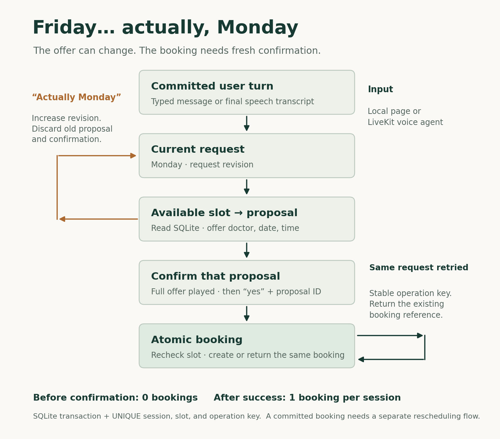
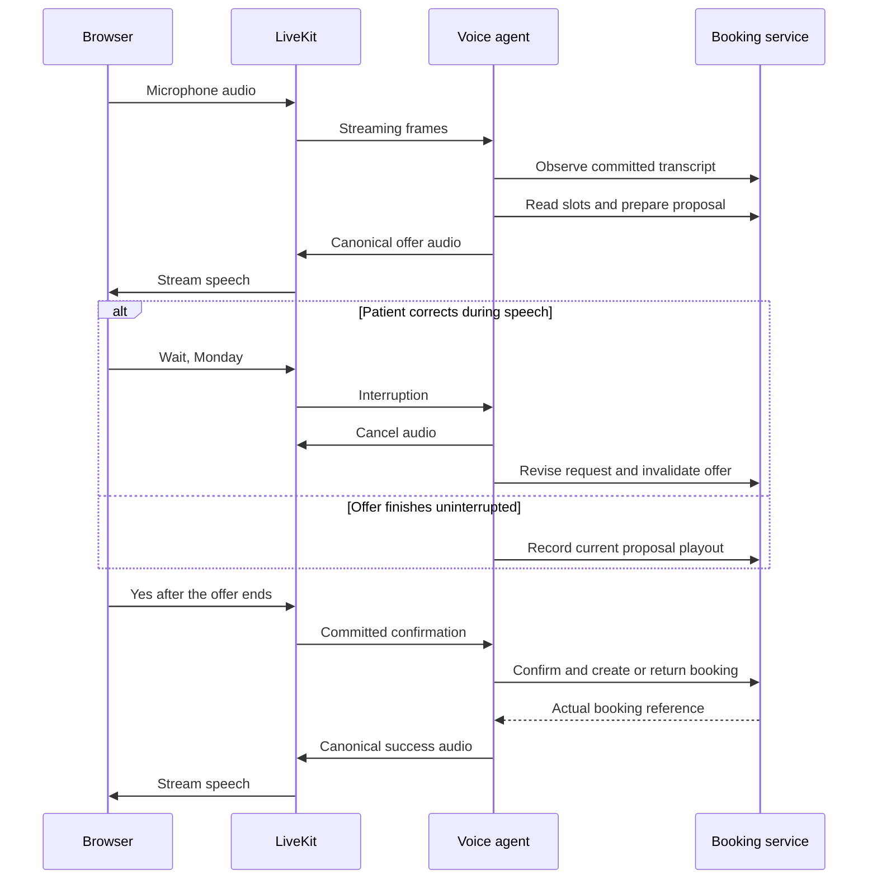

# Build a voice agent that books appointments

*A Python and LiveKit tutorial: check mock availability, handle a correction, ask for confirmation and save one booking.*

A patient says:

> “Book me a dermatologist appointment Friday… actually, make that Monday.”

The useful response is an available Monday appointment with a named doctor and a time. The useful outcome is a single booking, created after the patient confirms that offer.

Those are different events. Hearing a date is not permission to book. Finding an available slot is not a reservation. Saying “your appointment is confirmed” is not evidence that anything was written to the database.

This project makes each event visible. You can change the day, see the current offer change, confirm it, and inspect the resulting booking and audit trail. Start with the local version, then connect the same service to a voice agent.

## Get the example running

`booking.py` holds the rules and `server.py` serves the API and browser page. Start with `demo_journey.py` to see the booking change before adding a microphone. Python 3.11 or 3.12 is enough for this local version.

Unzip the project, open a terminal in `clinic_booking_demo`, and run:

```bash
python3 demo_journey.py
```

The script fixes its clock to 14 October 2026 and creates a temporary database. Your output will follow this sequence; the booking reference is generated on each run:

```text
PATIENT: Friday
AGENT: Dr Mira Rao has Friday, 16 October at 09:00 AM IST available. Shall I book that?
BOOKINGS: 0
PATIENT: Actually, make that Monday
AGENT: Dr Mira Rao has Monday, 19 October at 09:00 AM IST available. Shall I book that?
BOOKINGS: 0
PATIENT: yes
AGENT: Booked with Dr Mira Rao on Monday, 19 October at 09:00 AM IST. Your reference is BK-…
BOOKINGS: 1
```

The final line is backed by a row in SQLite. The program does not ask a language model to invent a booking reference.

To try the interactive page:

```bash
python3 server.py
```

Open **http://127.0.0.1:8000**. Type the entire Friday → Monday sentence, or send it as two turns. Read the offered slot, then type `yes`. The page shows the current request, booking count, and backend events. Reloading restores the same session. **New session** creates a separate fictional patient.

The browser demo uses today's date in Asia/Kolkata. Its weekday interpretation is the next occurrence *after* today; if today is Monday, “Monday” means next Monday. Use `YYYY-MM-DD` when you want an exact date. The fixed-clock terminal example avoids that ambiguity when reproducing the tutorial.

On Windows, replace `python3` with `py`. If the timezone database is missing, run `py -m pip install tzdata`.

## Put the booking state outside the conversation



The state has four pieces that are easy to confuse:

| State | What it means | What changes it |
|---|---|---|
| Request | The patient currently wants Monday | A new committed user utterance |
| Proposal | A particular doctor, date, and time has been offered | A validated availability result |
| Confirmation | The patient accepted that particular proposal | An explicit confirmation utterance tied to its ID |
| Booking | The appointment exists in the database | A successful transaction after validation |

Each request has a `revision`. Each new offer has a `proposal_id`; repeating the same current offer keeps its ID. These values matter when operations finish in a different order from the conversation.

Imagine that a Friday search begins. The patient then says Monday. The Friday search finishes late. Its result carries the old revision, so it cannot become the current offer. Otherwise the agent could politely acknowledge Monday while preparing a Friday booking.

In `booking.py`, a supported date request does this:

```python
db.execute("""
    UPDATE sessions SET preferred_date=?, preferred_time=?, revision=revision+1,
    proposal_id=NULL, slot_id=NULL, confirmed_proposal=NULL, played_proposal=NULL
    WHERE id=?
""", (requested, wanted_time, session_id))
```

Another explicit request for the same weekday resets confirmation. “Different doctor on Monday” must not reuse approval for the previous doctor. This example does not yet understand doctor preferences; it protects the old approval while that feature remains unimplemented. A clarification such as “Is that Monday?” is handled separately and preserves the current offer.

The parser recognizes English weekdays and ISO dates, using the last supported date mention in the target sentence. That handles “Friday… actually Monday.” Negated or conditional choices such as “not Monday unless Friday is unavailable” clear the pending choice and ask for clarification. It is a small, explicit vocabulary, not a general natural-language date parser.

## Preserve the time when the patient changes the day

Try these messages in the browser:

```text
Friday at 10 AM
Actually Monday
Is that Monday?
yes
```

The Monday offer must still be at 10 AM. The question must repeat the current offer without replacing it. Only the final yes can create a booking.

The session stores `preferred_time` as `HH:MM`, alongside `preferred_date`. Changing only the day preserves the time; changing only the time preserves the day. “Any time” clears the time constraint. Numeric forms such as `10 AM`, `2 PM` and `14:00`, and a few spoken forms such as `ten a.m.`, are supported. “At ten” needs AM or PM; a range such as “between nine and two” needs a more specific choice.

Availability and the final booking check both apply this constraint. The language model cannot select a 9 AM slot for a request that still says 10 AM. If 11 AM is unavailable, the service returns no matching offer and lists real alternatives. The patient must choose one before the service prepares a new proposal.

`asks_about_offer()` recognizes a short list of clarification forms, including “Is that Monday?”, “Did you say Monday?” and “What time is that?” It reads the stored doctor, date and time, leaves the revision and proposal unchanged, and does not create consent. “Can you do Monday at 10 AM?” remains a new request. Explicit corrections take precedence over clarification wording.

## Make mock availability behave like availability

The project seeds three slots on each weekday over the next 21 days, with fictional doctors. Those slots live in SQLite. A booking removes a slot from subsequent availability queries.

The essential query is:

```sql
SELECT s.*
FROM slots s
LEFT JOIN bookings b ON b.slot_id = s.id
WHERE b.id IS NULL
  AND substr(s.starts_at, 1, 10) = ?
  AND s.starts_at > ?
  AND (? IS NULL OR substr(s.starts_at, 12, 5) = ?)
ORDER BY s.starts_at;
```

The parameters are the requested date, current timestamp and requested time (passed twice, or null if the caller has no preference). All seeded timestamps use the same timezone offset, so that timestamp comparison is adequate for this demo. A system with mixed offsets should normalize timestamps before comparing them.

The offer operation checks the request revision again and verifies that the selected slot is still available for that date. It prepares a proposal without inserting a booking.

There is no temporary hold. Two patients can be offered the same unbooked slot. Only one can commit it; the other gets a conflict and must choose again. That is an explicit tradeoff for this small example. A real scheduling product might add a short hold with an expiry.

## Confirm the current offer

The local page submits the proposal ID visible when the patient sends `yes`. A confirmation for an old proposal is rejected even if another offer now exists.

The accepted phrases are deliberately narrow: `yes`, `yes please`, `confirm`, `confirm booking`, `book it`, `yes book it`, and `yes confirm`. `haan` is not accepted as confirmation. “Yes, but actually Monday” changes the date before any confirmation is recorded.

The voice agent follows the same contract. Its committed-user-turn hook sends the actual user transcript to the service. The LLM's booking tool has no confirmation boolean that it can simply set to true.

The final write checks:

```python
if (proposal_id != session["proposal_id"]
        or proposal_id != session["confirmed_proposal"]):
    raise BookingError("The current offer needs explicit patient confirmation.")
```

A transcript is still not proof of what the person intended. STT can misrecognize speech, and an English “yes” can be a backchannel while an offer is being spoken. The voice implementation waits for uninterrupted SDK offer playout and captures eligibility when the next user utterance starts. A yes that began during the offer is rejected even if its transcript arrives after the offer ends. SDK playout is still a software signal; browser audio and physical listening belong in the live acceptance run.

## Make retrying safe

Suppose the database commits a booking, but the HTTP response is lost. Retrying the operation should return the existing booking reference.

This service derives a stable operation key from the proposal:

```python
operation_key = "booking:" + proposal_id
```

It checks for an existing booking with that key before attempting an insert. Reusing the key with a different session or proposal is rejected. Separate turn IDs also make exact user-turn retries repeat the cached response instead of processing the turn twice.

The database adds three constraints:

```sql
session_id TEXT NOT NULL UNIQUE,
slot_id TEXT NOT NULL UNIQUE,
operation_key TEXT NOT NULL UNIQUE
```

They protect different things: one booking per session, one patient per slot, and one result per operation key. SQLite's [UNIQUE constraint documentation](https://www.sqlite.org/lang_createtable.html#unique_constraints) describes the database enforcement.

Availability is checked and the booking is inserted inside `BEGIN IMMEDIATE`. SQLite allows one writer at a time; an immediate transaction obtains the write transaction before the check-and-insert sequence. Another caller either waits or receives a locking error. The constraints remain a final defense against conflicting rows. See SQLite's [transaction documentation](https://www.sqlite.org/lang_transaction.html).

The guarantee is local and specific: after a successful confirmed operation, retries for that proposal return one persisted booking. It is not a guarantee of exactly-once network delivery. When replacing SQLite with an external clinic API, use that API's idempotency support if available, persist the operation key before sending, and reconcile unknown outcomes before issuing a new booking request.

An appointment already committed remains booked when the patient changes the day. The demo reports that rescheduling is required. Cancelling TTS, an asyncio task, or an HTTP wait does not undo a committed database operation.

## Check the failure cases before adding speech

Run:

```bash
python3 -m unittest discover -s tests -v
```

The Python and JavaScript suites cover booking, HTTP, voice policy, installed-SDK behavior and client lifecycle. The exact results and their limits are recorded in `docs/validation_results.json`. The booking cases include:

| Attempt | Required result |
|---|---|
| Friday → Monday → yes | One Monday booking |
| Friday and Monday in one utterance | Monday offered; no booking before yes |
| Direct booking call without confirmation | Rejected |
| Old Friday offer confirmed after Monday correction | Rejected |
| Same booking request retried | Same booking ID |
| Two concurrent writes for one patient | One booking |
| Two patients compete for one slot | One successful booking |
| Correction arrives after confirmation but before commit | Old proposal rejected |
| Friday at 10 AM → Monday | Time remains 10 AM |
| Is that Monday? → yes | Same offer; one booking |
| Request 11 AM when only 9 AM, 10 AM and 2 PM exist | No substituted offer; ask the patient to choose |
| Page reload after success | Same persisted booking restored |

These tests exercise the booking contract. They do not establish STT accuracy, natural turn-taking, or truthful spoken responses from the LLM.

## Connect the browser to the streaming voice agent

The page now uses the LiveKit JavaScript client. Microphone audio goes through WebRTC to the same LiveKit agent that calls the booking service. The agent's TTS audio returns on a remote audio track. Browser speech recognition is no longer involved.

The token endpoint creates a short-lived token for one room and dispatches agent `clinic-booking` with the current booking session ID. The agent joins that room and uses the same session in SQLite. Reconnect preserves the booking; it does not secretly create another patient.



Use Python 3.11 or 3.12. Install [uv](https://docs.astral.sh/uv/getting-started/installation/), create a [LiveKit Cloud](https://cloud.livekit.io/) project, then run:

```bash
uv sync --locked --extra voice
cp .env.example .env
```

In PowerShell, use `Copy-Item .env.example .env`. Fill in:

```dotenv
LIVEKIT_URL=wss://your-project.livekit.cloud
LIVEKIT_API_KEY=your-project-key
LIVEKIT_API_SECRET=your-project-secret
BOOKING_API_URL=http://127.0.0.1:8000
```

Start terminal 1:

```bash
uv run --extra voice server.py
```

Start terminal 2:

```bash
uv run --extra voice voice_agent.py download-files
uv run --extra voice voice_agent.py dev
```

Open `http://127.0.0.1:8000`, click **Connect voice**, and grant microphone access. If autoplay is blocked, click **Enable audio**. The page's **Mute** button toggles the published microphone. Text submission is disabled for a voice session so a typed yes cannot bypass the spoken-offer rule.

The JavaScript client is bundled locally. If you modify `web/voice_client.js`, rebuild it with:

```bash
npm ci
npm run build
```

The Python SDK is pinned to `livekit-agents[silero]==1.8.7`; the JavaScript client is pinned to `livekit-client==2.22.4` in `package.json`. The adapter uses Deepgram Nova-3 STT, Gemma 4 31B, Fish Audio S2.1 Pro TTS, Silero VAD, and LiveKit's turn detector. Live providers need the configured account; model access and charges depend on that account. LiveKit's [quickstart](https://docs.livekit.io/agents/start/voice-ai/) covers the provider/session setup.

## Read the exact offer, then enable approval

The tools remain small:

| Tool | What it does |
|---|---|
| `find_availability()` | Reads actual available slots and the current revision |
| `offer_appointment(slot_id, revision)` | Validates the slot, speaks its doctor/date/time, and records completed playout |
| `create_booking()` | Books a confirmed current proposal and speaks the actual returned reference |

The offer text is assembled from backend values. `session.say()` handles synthesis and streaming. The LLM does not paraphrase a different doctor or time after the tool. `StopResponse` ends the generated reply after the canonical speech.

The essential playout gate in `voice_flow.py` is:

```python
handle = say(text)
await handle.wait_for_playout()

if (handle.interrupted or handle.exception() is not None
        or error_epoch != self.provider_error_epoch
        or sequence != self.sequence):
    return {"error": "The offer was interrupted or became stale."}

state = await self.call("/api/voice/played", {
    "session_id": self.session_id,
    "proposal_id": result["proposal_id"],
    "revision": revision,
})
```

The callback is authorized with a server-side key derived from the LiveKit API secret. That key is never sent to the browser or added to the room token. The booking service rejects voice confirmations until its current proposal has a matching playout receipt.

There is another timing trap: a person can begin saying yes while TTS is still speaking, and STT can finalize that yes after the offer ends. Checking only the state at transcript arrival would accept it. The voice flow therefore captures the eligible proposal when user speech starts:

```python
def user_started(self):
    self.confirmation_at_start = self.completed_proposal
```

A clarification such as “What time is that?” preserves approval eligibility if the backend still reports the same fully played proposal and no provider error occurred. A correction or decline clears it. This is covered by regression tests.

The committed-turn hook passes that captured ID to the service. If it was absent at speech start, the yes is rejected. The agent must read the offer again. LiveKit's [pipeline hooks](https://docs.livekit.io/agents/logic/nodes/) and [speech/event reference](https://docs.livekit.io/reference/agents/events/) explain where these callbacks fit.

Preemptive generation is disabled initially. The session uses a 0.65–2 second endpointing range and adaptive interruption handling. Those are starting settings; tune them using recorded pauses and corrections rather than treating them as universal thresholds.

## Measure and test the voice layer

Run both test suites:

```bash
uv run --extra voice -m unittest discover -s tests -v
npm ci
npm test
```

Two tests use the installed LiveKit AgentSession and tool scheduler with deterministic model/audio fixtures. They check that real TTS frames wait for output-device completion, and that interrupting a real SpeechHandle clears buffered audio and leaves the offer unapproved. Other tests cover late STT confirmation, cancellation, provider failure, stale playout receipts, token permissions, callback authorization, and microphone/remote-track lifecycle.

The real-browser checks also passed for local booking, reload, bundled SDK startup without credentials, and mobile layout, with no page errors. Those are integration and contract checks, not evidence of live STT accuracy or physical playback. The SDK text test helper bypasses the audio turn hook; the test explicitly feeds that hook before exercising tool scheduling. Its TTS provider and output sink are fixtures.

The browser now displays agent state, current offer readiness, and server response/interruption intervals. **Download voice trace** exports the actual received events, including SDK per-turn metrics when supplied. Server state intervals exclude browser buffering and speaker delay. The unit-test timing values are controlled inputs, not voice benchmarks.

Follow `docs/voice_validation.md` for the actual microphone run: pause inside the Friday request, correct the date during playback, say yes too early, try backchannels, reconnect after success, and confirm one booking. Save the trace and a short recording. Account credentials have been configured in the development environment, but successful API authentication has not established a working microphone call. Live providers, physical playback and live latency percentiles remain unvalidated. The current startup blocker is recorded in the validation guide.

## Add the project to GitHub

Keep the first repository private. In the project directory, with Git and the [GitHub CLI](https://cli.github.com/) installed:

```bash
git init -b main
git add .
git commit -m "Add mock clinic booking demo and tests"
gh auth login
gh repo create clinic-booking-demo --private --source=. --remote=origin --push
```

The `--private`, `--source`, and `--push` behavior is documented in [GitHub's repository creation command](https://cli.github.com/manual/gh_repo_create). Before committing, `git status --short` should show source files and documentation; `.env`, the virtual environment, and SQLite data are ignored by the included `.gitignore`.

If you prefer the website, create a private empty repository at [github.com/new](https://github.com/new?name=clinic-booking-demo&visibility=private). Leave its README and other initialization options empty because the project already has them. After the local commit, use the remote URL GitHub gives you:

```bash
git remote add origin https://github.com/YOUR_USERNAME/clinic-booking-demo.git
git push -u origin main
```

The included GitHub Actions workflow runs the booking tests on each push and pull request. GitHub stores the source; it does not run the Python booking service just because the files are uploaded. GitHub Pages alone cannot host this backend.

## Is this architecture current, and how much latency work is needed?

LiveKit's current [pipeline comparison](https://docs.livekit.io/agents/models/pipelines/) supports cascaded, speech-to-speech, and hybrid architectures. It recommends the STT–LLM–TTS pipeline when control, tool use, debugging, and an audit trail matter. Those fit this booking example: the doctor/date/time must come from the service and the offer should be spoken exactly. This design is a reasonable choice for the tutorial.

Start by demonstrating correct voice bookings, corrections, interruptions, and retries. A long pause or an agent that keeps talking after “wait” will make a working backend feel broken, so measure basic responsiveness once those journeys work. A full performance study is optional for the first post.

LiveKit's [observability guide](https://docs.livekit.io/testing/observability/data/) exposes per-turn `e2e_latency`. Its [simulation guide](https://docs.livekit.io/testing/simulations/) evaluates both task behavior and responsiveness and distinguishes agent-side timing from what the caller actually hears.

After running the real microphone demo, click **Download voice trace** and calculate the available metrics:

```bash
python3 latency_report.py ~/Downloads/clinic-voice-trace.json
```

The report shows sample counts, p50 (the typical result), and p95 (the slow end). It keeps SDK end-to-end latency separate from server response/interruption intervals. Values missing from the trace stay null. A small sample is exploratory; publish its count and repeat the experiment before making performance claims.

## Record something a reviewer can inspect

The download includes `docs/typed_walkthrough.mp4`, an automated recording of the local page with typed input. It shows the date correction, 10 AM selection, clarification, confirmation and a retry. It contains no microphone audio. Use it to inspect the booking behavior; the live voice recording is still pending.

A short screen recording can show the actual contract: request Friday, correct it to Monday, show zero bookings, confirm the Monday offer, show one booking and its reference, then retry and show the same reference. Keep the audit trail visible.

Pair that recording with the test command, the diagram, and one explained failure case—such as a late Friday search rejected after the Monday correction. That gives readers something they can reproduce and challenge.

The next step is to validate the live voice path with recorded corrections, pauses and interruptions. Doctor preferences and rescheduling remain separate features. The contract in this project stays small: the appointment written to the database matches the current confirmed offer, and a retry returns that booking.
